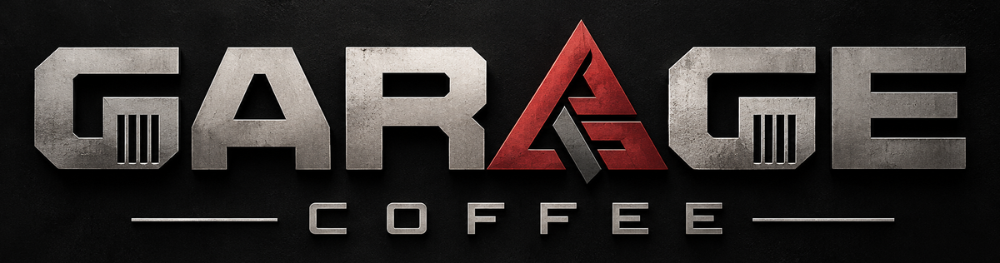

<picture>
  <source media="(prefers-color-scheme: dark)" srcset="public/garage-brand/garage-coffee-logo.png">
  
</picture>

# GARAGE OS

### A connected operating platform for modern hospitality businesses

**Point of Sale · Service Operations · Production · Inventory · Finance · Customer Experience**

An operations-focused software project developed around real café workflows in Indonesia.

[Project overview](#overview) · [Capabilities](#platform-capabilities) · [Architecture](#architecture) · [Local development](#local-development) · [Documentation](#documentation) · [Security](#security--responsible-disclosure)

---

## Overview

**Garage OS** is a modular business-operations application built to coordinate the workflows behind Garage Coffee: order entry, cashier operations, bar and kitchen production, table service, purchasing, stock movement, finance, membership, and owner oversight.

The project explores how a single digital workspace can reduce fragmented processes and improve operational visibility for independent hospitality businesses. It is based on real operating requirements; the presence of a feature in the repository **does not automatically establish that the feature is fully tested, deployed, or production-ready**.

> **Public repository notice:** The source code is visible for review, but a full public open-source release is **not yet complete**. Licensing, privacy, and publication security are under review. Do not assume the current default branch grants redistribution rights. See [Release and licensing](#release-and-licensing) before reusing code.

### Design principles

- **Operations first:** Clear order ownership, production states, and financial reconciliation.
- **Role-aware workflows:** Different workspaces for owners, cashiers, waiters, bar, kitchen, and other authorized staff.
- **One connected data flow:** Shared transaction and production events instead of disconnected manual reporting.
- **Auditability:** Verifiable operational events, approvals, and accountable financial changes.
- **Incremental engineering:** Clear separation of implemented modules, work in progress, and concepts requiring validation.

## Platform capabilities

| Area | Scope represented in the codebase |
| :-- | :-- |
| **Point of Sale (POS)** | Menu and variant selection, cashier transactions, receipts, payment records, and shift workflows. |
| **Waiter & table service** | Table selection, staff-entered orders, service requests, and order handoff. |
| **Bar & Kitchen Display** | Production queues, item/ticket statuses, and coordination with waiter service. |
| **Warehouse & inventory (WMS)** | Inventory items, stock movements, supplier receiving, transfers, and stocktaking workflows. |
| **Finance & reporting** | Cash sessions, expenses, payment reconciliation, approvals, and operational reporting modules. |
| **CRM & membership** | Customer records, member accounts, loyalty points, voucher-related capabilities, and protected member pages. |
| **Owner & management workspace** | Role-based dashboards, team administration, audit logs, and operational oversight. |
| **Website & digital menu** | Public-facing business information and menu discovery. **Customers browse the digital menu; ordering is handled by authorized staff.** |
| **AI-assisted operations** | Assistant concepts, alert and reporting integrations, and selected implementation components requiring environment-specific evaluation. |

**Scope disclaimer:** This is a map of repository capabilities, not a certification that every workflow is complete. Some modules depend on external services, credentials, manual UAT, and venue-specific configuration. For the more detailed repository inventory, see [Feature Map](docs/FEATURE_MAP.md).

## Architecture

The application uses the **Next.js App Router** for pages and API handlers, **TypeScript** for application logic, **Drizzle ORM** for database access, **Better Auth** for identity/session management, and **PostgreSQL** for the production-oriented database stack. **PGlite** is also used for isolated local development.

~~~mermaid
flowchart LR
    Customer["Customer digital menu: browse only"] --> Waiter["Waiter enters order"]
    Waiter --> POS["Garage OS POS / Order"]
    POS --> Bar["Bar production queue"]
    POS --> Kitchen["Kitchen production queue"]
    Bar --> Ready["Ready items"]
    Kitchen --> Ready
    Ready --> Service["Waiter service and handoff"]
    POS --> Finance["Payments & finance"]
    POS --> Inventory["Inventory & stock"]
    POS --> Owner["Owner dashboard & audit"]
~~~

The diagram describes the intended connected workflow. A visual status is not, on its own, proof that a physical handoff or payment verification occurred.

### Technology

| Layer | Technology |
| :-- | :-- |
| Web application | Next.js 16, React 19, TypeScript |
| UI | Tailwind CSS 4, shadcn/ui, Radix UI, Lucide |
| Motion and visualization | GSAP, Framer Motion, Three.js (where used) |
| Server/API | Next.js route handlers |
| Persistence | PostgreSQL / PGlite, Drizzle ORM |
| Authentication | Better Auth, role-based application access |
| Testing | Vitest, Playwright, ESLint, TypeScript |
| Deployment components | Docker Compose, Caddy, GitHub Actions (project-specific infrastructure) |

## Repository orientation

~~~text
.
├── src/
│   ├── app/             # Application pages and API routes
│   ├── components/      # UI and workflow components
│   ├── db/              # Schema, migrations, and data access
│   └── lib/             # Shared application logic
├── drizzle/             # Database migration files
├── public/              # Approved public/static assets
├── docs/                # Architecture, guides, and operational documentation
├── e2e/                 # End-to-end tests
├── scripts/             # Development and operational scripts
├── Dockerfile
├── docker-compose.yml
└── package.json
~~~

**Note:** Some repository directories contain business-specific resources and are still under publication review. Visibility of a directory is not permission to access or reuse real business records, private assets, or production systems.

## Local development

The following is a **development-only** starting point. Use a disposable local database and synthetic data; never point these commands at an existing Garage Coffee production database.

### Requirements

- Node.js 22 and npm (the repository's CI uses Node.js 22).
- Git.
- An isolated local workspace with sufficient resources for a Next.js application and local database.

### 1. Install dependencies

~~~bash
git clone https://github.com/killuasurya-boop/garage.git
cd garage
npm ci
~~~

### 2. Configure a local environment

Create an untracked `.env.local` in the repository root. The values below are **examples of variable names, not usable secrets**:

~~~dotenv
GARAGE_DB_DRIVER=pglite
PGLITE_DATA_DIR=.pglite-data
BETTER_AUTH_URL=http://localhost:3001
BETTER_AUTH_SECRET=REPLACE_WITH_A_UNIQUE_RANDOM_SECRET
GARAGE_SEED_PASSWORD=REPLACE_WITH_A_UNIQUE_LOCAL_PASSWORD
GARAGE_MEMBER_SEED_PASSWORD=REPLACE_WITH_ANOTHER_UNIQUE_LOCAL_PASSWORD
GARAGE_POS_API_KEY=REPLACE_WITH_ANOTHER_UNIQUE_RANDOM_KEY
~~~

Generate separate high-entropy values for all secret-bearing variables. Never commit `.env.local` or copy historic demonstration credentials into a deployed environment.

### 3. Prepare the isolated database and start

~~~bash
npm run db:bootstrap-pglite
npm run dev
~~~

Visit **http://localhost:3001**. If your local workflow requires demo accounts, review the seed script before running `npm run db:seed` **against your disposable local database only**.

> **Important:** Database initialization may require additional configuration or troubleshooting depending on your operating system and current migration state. Do not execute seed, repair, restore, or migration commands against a live system without a reviewed backup and explicit authorization.

### 4. Quality checks

~~~bash
npm run lint
npx tsc --noEmit -p .
npm test
npm run build
~~~

The repository also includes Playwright and additional operational smoke/UAT scripts. These commands are documented capabilities, **not a claim that all checks currently pass**.

## Documentation

| Reference | Purpose |
| :-- | :-- |
| [System Overview](docs/SYSTEM_OVERVIEW.md) | High-level architecture and module relationships |
| [Feature Map](docs/FEATURE_MAP.md) | Source-based feature inventory and caveats |
| [Technical Guide](docs/README_TECHNICAL.md) | Local development, database, build, and troubleshooting |
| [User Guide](docs/README_USER.md) | Role-based application introduction |
| [Screen Manual](docs/APP_GUIDE/SCREEN_MANUAL.md) | Navigation and screen documentation |
| [Deployment Checklist](docs/DEPLOYMENT_CHECKLIST.md) | Operational release review |
| [Brand Asset Policy](docs/GARAGE_BRAND_ASSET_POLICY.md) | Rules for use of official Garage Coffee artwork |

Some older technical documents describe historical behavior and may not match current product decisions. Validate against the current code and accepted operational rules.

## Community and contributions

Garage OS is interested in reusable approaches to hospitality operations, including order state management, production queues, inventory workflows, and accessible interfaces.

- Browse [Issues](https://github.com/killuasurya-boop/garage/issues) for repository discussions.
- Review proposed [contribution and security documentation](https://github.com/killuasurya-boop/garage/pull/209).
- Do not submit real transactions, personally identifiable information, credentials, or sensitive operational screenshots.
- Code contribution and redistribution terms will be finalized after the project-wide licensing and asset review.

Contributions may be reviewed, but **a general-purpose open-source contribution policy is not yet finalized**.

## Security & responsible disclosure

Please do not disclose vulnerabilities, secrets, customer records, or sensitive production details in public GitHub issues.

The repository is undergoing a publication security review. The [security-hardening proposal](https://github.com/killuasurya-boop/garage/pull/210) includes documentation, handling of tracked internal artifacts, and automated checks. These measures **do not retroactively remove material from Git history**.

Use GitHub's private vulnerability reporting feature if available, or contact a maintainer privately through an established channel. Testing of live Garage Coffee services requires explicit authorization.

## Release and licensing

| Item | Current position |
| :-- | :-- |
| Source visibility | Public |
| Project-wide license on `main` | **Not yet published** |
| Proposed license | Apache License 2.0, pending review in [PR #209](https://github.com/killuasurya-boop/garage/pull/209) |
| Publication/security review | In progress, see [PR #210](https://github.com/killuasurya-boop/garage/pull/210) |
| General open-source release | **Not yet declared** |

**Publicly viewable source code is not automatically open-source-licensed.** Until a license is adopted for an explicitly defined distribution scope, do not assume you can copy, redistribute, or commercially reuse the repository contents.

The Garage Coffee and Garage OS identities, original logos, and brand artwork are **not automatically granted for reuse** by any proposed source-code license.

---

**GARAGE OS — Building more connected, accountable everyday operations.**

Developed around [Garage Coffee](https://garagecoffee.id/) · [GitHub project](https://github.com/killuasurya-boop/garage)

