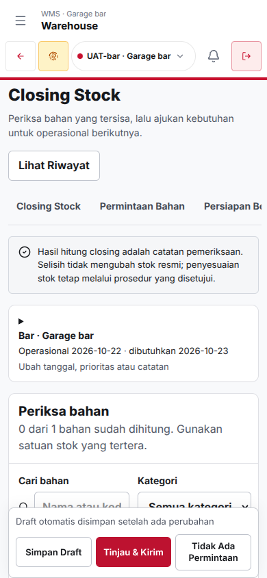
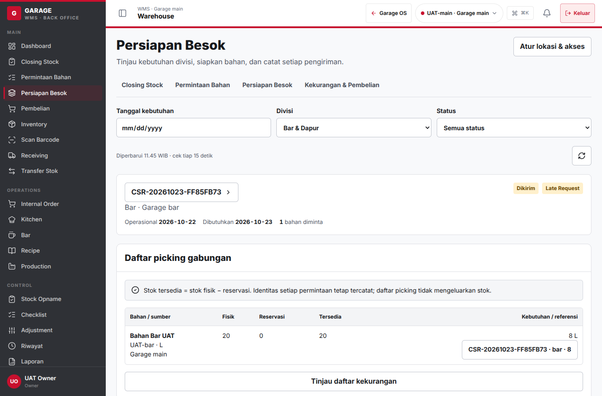

# Validasi Closing Stock & Replenishment — Garage Coffee

Tanggal pemeriksaan: 23 Oktober 2026 WIB. Seluruh fixture dan browser UAT menggunakan database sementara terisolasi, bukan database operasional Garage Coffee.

## Sumber kode

- Main: `2288176269eacd2271b8cd6012c5c50fc847448d`.
- W2 PR63: `b60a045b929551dcee843e94cc6e2c2815a90a71`, termasuk dalam integrasi yang masuk main melalui PR64.
- Implementasi dan pengujian lengkap: `5d359276f96e7be9bda84502f8dc10a536f7692f`.
- Revisi akhir izin tombol persetujuan: `4d2e354e4b30549d111ed3c5f19f9a4907e5d0c6`. Perubahan satu baris menyelaraskan tampilan tombol dengan izin backend yang membatasi persetujuan ke manajemen.
- PR: https://github.com/killuasurya-boop/garage/pull/64 , merged pada 23 Oktober 2026 pukul 11.38 WIB oleh akun Owner. Main merge commit `3f434b9a1d48870e52b6696b7cb5cf52f1b2392b` mempunyai tree yang sama dengan revisi akhir `4d2e354`.

## Hasil otomatis yang sudah terbukti

CI revisi akhir `4d2e354`: https://github.com/killuasurya-boop/garage/actions/runs/39869455321 . Typecheck, lint dan seluruh **157 file / 1.021 tes lulus**. Lint tidak memiliki error; satu warning lama mengenai `GARAGE_BRAND_LOGO_SRC` yang tidak digunakan pada POS view.

Pengujian terfokus lokal mencakup 49 tes: 15 validasi/API/migrasi, 12 integrasi closing, dan 22 regresi service/transfer/sale-stock/receiving/reset/migrasi impor. Ini merupakan bagian dari pemeriksaan keseluruhan, bukan jumlah yang ditambahkan ke total CI.

| Pemeriksaan | Bukti |
| --- | --- |
| Data POS dan keuangan terlindungi | SHA-256 sebelum/sesudah setiap skenario integrasi sama untuk kategori, menu, varian, order aktif, item order, pembayaran, sesi kas dan tabel keuangan/purchasing fixture. |
| Akses backend | Divisi/outlet/penugasan yang salah ditolak; supplier approval dan penyelesaian selisih dibatasi ke manajemen. |
| Idempotensi dan konflik | Replay tidak menambah mutasi/event; payload berbeda, versi usang dan penggunaan stok yang direservasi ditolak. |
| Pengiriman | FEFO, batch/expiry, sumber→transit, penerimaan parsial/baik/rusak serta rollback setelah baris pertama sudah diproses diperiksa. |
| Selisih | Manajemen hanya dapat menutup setelah seluruh alokasi dipertanggungjawabkan, reservasi nol dan alasan valid; saldo serta jumlah baik/rusak tidak diubah. |
| Picking gabungan | Kebutuhan tidak berulang ketika ada dua gudang sumber; reservasi tetap terikat sumber sebenarnya dan draft tidak masuk persiapan. |
| Ekspor | CSV/XLSX/PDF dibaca kembali; seluruh 250 baris fixture sesuai filter disertakan, identitas pembuat disertakan dan formula CSV dilindungi. |
| Migrasi | DDL147 diuji strict, snapshot lama tetap sama, rantai0145→0146→0147 konsisten, tabel POS fixture tetap. `db:generate` berikutnya tidak menghasilkan perubahan schema. |

File bukti utama: `src/lib/wms-replenishment.integration.test.ts`, `wms-replenishment-api.test.ts`, `wms-replenishment-validation.test.ts`, `wms-replenishment-migration.test.ts`.

## Build dan browser

Build standalone produksi pada commit `5d35927` selesai exit0, termasuk pemeriksaan TypeScript dan 314 halaman statis. Menggunakan konfigurasi memory optimization yang sudah tersedia di main dan heap 6 GB; pemeriksaan tipe tidak dilewati.

Build standalone revisi akhir `4d2e354` selesai exit0. Kompilasi ini memakai heap 6 GB, `GARAGE_STANDALONE=true`, `GARAGE_BUILD_WEBPACK_MEMORY_OPTIMIZATIONS=true` dan `GARAGE_BUILD_TYPECHECK_VERIFIED=true`, sesuai jalur constrained-builder yang tersedia di main. Pemeriksaan tipe penuh dilakukan terpisah oleh CI #177 pada revisi yang sama; pemeriksaan tipe duplikat dalam build lokal ini dilewati.

Browser UAT pada aplikasi standalone produksi **lulus** dengan akun terpisah Owner, Bar dan Warehouse Staff:

- Bar mengisi hitungan dan mengirim permintaan melalui HP.
- Tombol persetujuan tersembunyi untuk petugas gudang sesuai kebijakan backend.
- Owner menyetujui; petugas gudang menjalankan persiapan, siap serah dan pengiriman melalui UI.
- Bar mengonfirmasi penerimaan melalui HP. Saldo divisi baru bertambah dari 2 menjadi 10 setelah konfirmasi 8 unit diterima.
- Owner memilih supplier terdaftar dan menyetujui usulan shortage melalui UI.
- Ekspor CSV/XLSX/PDF dari endpoint aktual berhasil; akses pengaturan oleh staf menghasilkan403.
- Enam capture pada desktop 1366×900 / mobile 390×844 tidak mengalami overflow dokumen horizontal; tidak ada page error.

Bukti visual dan hasil terstruktur ada pada direktori `docs/uat/closing-stock/`. Semua nama bahan, akun dan angka dalam capture adalah fixture UAT terisolasi; tidak diimpor ke database Garage Coffee.

CI revisi akhir: https://github.com/killuasurya-boop/garage/actions/runs/39869455321 .

## Batas release dan tindak lanjut

- Pengujian lokal tidak menjalankan merge, migrasi atau deployment produksi. Owner kemudian menggabungkan PR64 secara terpisah; workflow Deploy VPS otomatis dimonitor melalui GitHub. Status aktual dicatat di bawah.
- Penerimaan pengadaan menggunakan Goods Receipt existing. Usulan shortage tidak membuat final PO/pembayaran otomatis dan belum menautkan dokumen PO/receipt secara otomatis.
- Forecast penjualan belum diaktifkan; minimum stock, hitungan fisik dan input manual tetap bekerja.
- Backup dan migrasi telah dijalankan oleh workflow VPS. Pemetaan lokasi/area/staf produksi dan prosedur barang rusak tetap memerlukan validasi menggunakan akun manajemen; pemeriksaan lokal memakai fixture. Pengujian multi-koneksi PostgreSQL staging belum dibuktikan dalam catatan ini.
- PGlite menguji SQL dan transaksi nyata secara terisolasi; pengujian ini tidak menggantikan validasi multi-koneksi pada PostgreSQL staging.
- Rollback setelah reservasi/pengiriman digunakan memerlukan penyelesaian/reversal terkontrol dan audit. Jangan menghapus tabel atau mereset ledger.

## Status release VPS

Workflow Deploy VPS https://github.com/killuasurya-boop/garage/actions/runs/39901374903 **SUCCESS** pada commit main `3f434b9a1d48870e52b6696b7cb5cf52f1b2392b`.

- Backup pre-deploy selesai 23 Oktober 2026 pukul 11.46.04 WIB.
- Migrasi `0146_master_import.sql` dan `0147_closing_replenishment.sql` diterapkan; runner melaporkan applied=2, skipped=148, OK.
- Aplikasi direstart dan pemeriksaan health workflow menghasilkan HTTP 200 pukul 11.46.31 WIB; cabang rollback tidak dijalankan.
- Pemeriksaan HTTP publik terpisah pukul 11.49 WIB: `/api/health`200 dengan JSON, serta `/api/wms/replenishment/catalog?division=bar`401 tanpa sesi. Ini membuktikan server sehat dan endpoint baru terlindungi, bukan pengujian transaksi memakai akun produksi.

CI push-main: https://github.com/killuasurya-boop/garage/actions/runs/39901375172 , tes penuh masih berjalan saat catatan ini disiapkan; Typecheck dan lint telah lulus. Kode tree sama dengan PR head yang sudah lulus 1.021 tes.

## Capture UAT terisolasi

