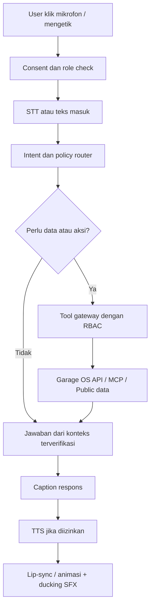
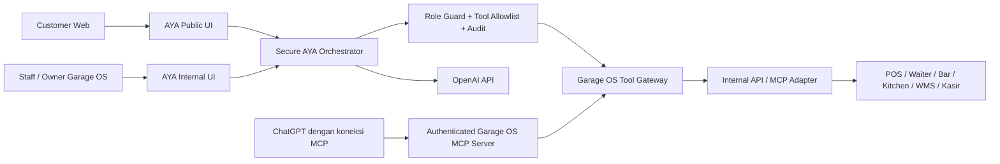

# AYA V2 ULTIMATE — MASTER SPECIFICATION UNTUK CLAUDE CODE

**Produk:** Garage Coffee / Garage OS  
**Pemilik keputusan:** Owner Garage Coffee  
**Tanggal dokumen:** 4 November 2026  
**Versi spesifikasi:** 1.0 — Consolidated Product Requirements & Implementation Blueprint  
**Status:** **Spesifikasi dan rencana implementasi; BUKAN laporan fitur yang sudah aktif**  
**Target penggunaan:** Claude Code, tim desain, engineering, QA, dan operasional  
**Bahasa utama produk:** Bahasa Indonesia

> **INSTRUKSI UTAMA UNTUK CLAUDE CODE**  
> Baca dokumen ini **secara menyeluruh** dan jadikan *source of truth* kebutuhan AYA V2. Audit repository, MCP, autentikasi, API, modul operasional, serta infrastruktur yang benar-benar tersedia **sebelum mengimplementasikan**. Lakukan pekerjaan pada branch aman, mulai dari implementasi paling bernilai, uji tiap fitur, dan jangan mengklaim suatu fitur sudah berjalan tanpa bukti pengujian. Jangan mengubah data production, mengaktifkan layanan berbayar, atau melakukan deployment production tanpa persetujuan yang sesuai.

---

## 0. Ringkasan Keputusan Owner

AYA V2 adalah **Living AI Assistant** untuk Garage Coffee dengan satu identitas karakter dan tiga konteks akses terpisah:

1. **AYA Public / Customer** di website dan menu digital: menyapa, berbicara, memahami pertanyaan, mengarahkan konten/menu, melakukan *smooth scroll* atas instruksi, menyorot elemen halaman, membantu melihat lokasi dan media sosial, menjelaskan cara memesan lewat waiter.
2. **AYA Staff / Supervisor** di Garage OS: membantu Waiter, Bar, Kitchen, Kasir, WMS, memandu SOP, memantau kejadian operasional aktual, memberi notifikasi dan suara ke **departemen yang tepat**, mendukung penyelesaian masalah.
3. **AYA Owner**: menjawab pertanyaan bisnis berbasis data aktual, membantu kontrol modul melalui Garage OS MCP/API yang aman, melihat pembaruan sistem, changelog, kesehatan deployment, masalah, rekomendasi, dan riwayat audit.

Identitas karakter: **maskot non-humanoid putih mungil**, mata sipit, tubuh lembut membulat seperti mochi/awan, tangan dan kaki kecil, ekspresi sangat imut, animasi kompleks namun ringan. **Bukan** manusia anime, gadis barista, robot humanoid, kucing bertelinga, atau avatar generik. Brand yang digunakan **Garage Coffee**, tanpa konsep otomotif.

AI utama yang diminta Owner: **OpenAI melalui API resmi** sebagai mesin percakapan dan pemilihan tindakan. MCP Garage OS menjadi sarana kontrol yang berotorisasi. **Langganan ChatGPT tidak otomatis mencakup biaya OpenAI API**; biaya inferensi, suara, server, dan hosting harus diaudit. Sebisa mungkin manfaatkan open-source untuk animasi, SFX, STT, dan TTS.

### 0.1 Aturan bisnis yang tidak boleh dilanggar

- **Customer tidak bisa memesan, membuat order, maupun checkout langsung dari menu digital.** Customer hanya dapat **melihat menu** dan meminta bantuan. **Waiter** memilih meja dan membuat pesanan; pesanan tersinkron ke POS serta Bar/Kitchen. Jangan diam-diam mengubah ketentuan ini.
- Peringatan Bar harus sampai ke **Bar**, Kitchen ke **Kitchen**, dan seterusnya; hindari suara pemberitahuan salah departemen.
- Informasi publik tidak boleh menampilkan data kasir, stok internal, karyawan, pendapatan, atau deployment internal.
- Owner memiliki kemampuan mengelola sistem melalui tool yang telah diberi izin, **bukan** akses AI tanpa batas. Perubahan berdampak besar/irreversibel tetap memerlukan otorisasi dan audit.
- Karyawan dibantu dan diingatkan secara profesional; AI tidak boleh otomatis menetapkan hukuman, tuduhan kecurangan, atau pemotongan gaji.
- Sistem operasional utama harus tetap bisa berjalan apabila AYA, OpenAI, suara, SFX, WebGL, atau MCP gagal.
- Update dan deployment hanya boleh disebut *berhasil* bila memiliki bukti status dan pemeriksaan yang sesuai, bukan sekadar ada commit atau build.
- Harga, menu, resep, HPP, stok, supplier, promo, link sosial media, dan jam operasional hanya boleh disampaikan berdasarkan sumber aktual yang valid.

### 0.2 Definisi sukses

1. Customer terbantu menemukan menu, informasi, lokasi, sosial media, dan cara pemesanan tanpa kebingungan.
2. Karyawan lebih cepat mengetahui pesanan/masalah yang perlu ditangani, dengan suara yang tidak mengganggu.
3. Owner dapat menanyakan kondisi operasional, melihat masalah prioritas, dan mengendalikan tindakan yang diizinkan melalui MCP/API.
4. Perubahan fitur serta hasil deployment dikomunikasikan dengan benar kepada penerima yang relevan.
5. Karakter terasa hidup, imut, profesional, dan tidak mengganggu dashboard produksi atau kasir.

---

## 1. Status Informasi dan Sumber Kebenaran

### 1.1 Yang merupakan keputusan kebutuhan

- Target platform: website publik/menu digital Garage Coffee dan aplikasi internal Garage OS.
- Website dan Garage OS sudah memiliki workflow operasional yang harus dipertahankan.
- Domain bisnis utama yang digunakan dalam proyek adalah `garagecoffee.id`; **jangan mengasumsikan endpoint atau subdomain aplikasi tertentu** sampai diperiksa di repo.
- Infrastruktur target Garage OS berjalan pada **VPS yang sudah ada**, bukan Hostinger Web Apps.
- Pengembangan utama dilakukan melalui **Claude Code**.
- OpenAI diminta sebagai *intelligence engine*; Garage OS MCP digunakan untuk koneksi kontrol/data yang aman.

### 1.2 Yang wajib diaudit, bukan diasumsikan

| Aspek | Tindakan Claude Code |
|---|---|
| Struktur repository/branch | Identifikasi repo, bahasa, package manager, lingkungan deploy dan workflow Git yang sebenarnya |
| Framework frontend/backend | Gunakan stack yang benar-benar ditemukan, bukan memaksakan Next.js/React jika repo berbeda |
| Otorisasi | Temukan role, permission, session, backend guards yang ada |
| Garage OS MCP | Enumerasi server, nama tool, resource, schema, izin baca/tulis, autentikasi dan audit |
| Data operasional | Temukan event dan API POS, Waiter, Bar, Kitchen, Kasir, WMS yang benar-benar tersedia |
| AYA lama | Audit komponen/asset/voice/notification yang bisa dipakai ulang |
| VPS | Ukur CPU, RAM, storage, GPU (jika ada), disk, bandwidth, latency, kapasitas proses audio |
| Deployment | Temukan CI/CD, webhook, health check, log, release notes, rollback dan status production |
| Instagram/lokasi/jam | Verifikasi tautan dan data resmi dari konfigurasi bisnis |
| Harga API/AI | Hitung estimasi dan batas penggunaan berdasarkan model serta volume nyata |

**Aturan sumber kebenaran:** Data aplikasi dan konfigurasi terverifikasi mengungguli jawaban AI; informasi dari percakapan bukan bukti bahwa status operasional saat ini sudah berubah.

---

## 2. Persona, Mode, dan Hak Akses

| Peran | Boleh melihat | Boleh meminta tindakan | Tidak boleh |
|---|---|---|---|
| **Customer** | Menu publik, deskripsi produk, harga tampil, promo valid, lokasi, sosial media, informasi umum | Scroll, sorot, cari menu, panduan cara pesan, buka link atas persetujuan | Melihat data internal atau membuat order/checkout di menu digital |
| **Waiter** | Meja, status order relevan, SOP pelayanan | Navigasi meja/order sesuai izin, menandai tindakan kerja yang disetujui | Mengubah kas, stok atau setting admin |
| **Bar** | Antrean minuman, resep, peringatan Bar | Acknowledge notifikasi, panduan kerja, aksi produksi sesuai modul | Membuka data kasir/pendapatan/Kitchen yang tidak perlu |
| **Kitchen** | Antrean makanan, resep, peringatan Kitchen | Acknowledge, aksi produksi sesuai modul | Mengubah data departemen lain tanpa hak akses |
| **Kasir** | Pembayaran, transaksi, tutup shift yang diotorisasi | Pencarian transaksi, pemeriksaan anomali, panduan rekonsiliasi | Mengubah nilai transaksi tanpa mekanisme approval dan audit |
| **WMS/Purchasing** | Bahan, stok, supplier, HPP, pembelian sesuai hak | Pencarian, pengusulan koreksi, review bukti bon | Mengubah HPP tanpa dasar bukti dan izin |
| **Supervisor** | Ringkasan departemen dalam wilayah tanggung jawab | Eskalasi, tindak lanjut, penugasan sesuai otorisasi | Akses Owner yang tidak diberikan |
| **Owner** | Data manajerial sesuai konfigurasi aktual | Analisis, kontrol tool yang diizinkan, permintaan perubahan dengan guard | Melewati konfirmasi sistem untuk tindakan berisiko tinggi |

Pemeriksaan akses harus terjadi **di backend pada setiap permintaan dan setiap pemanggilan tool**. Jangan hanya menyembunyikan tombol pada frontend.

---

## 3. Desain Karakter — AYA Living Mascot

### 3.1 Identitas visual wajib

- Maskot non-humanoid, putih lembut, bentuk membulat seperti mochi/awan.
- Mata sipit khas Aya menjadi ciri utama. Mata dapat berubah sedikit sesuai ekspresi tanpa kehilangan identitas.
- Mulut kecil ekspresif; tangan-kaki mini; boleh memiliki antena digital mungil.
- Aksen merah hangat Garage Coffee secukupnya; **bukan** dominasi neon ungu/pink/anime.
- Material halus dan hangat, pencahayaan natural, bayangan lembut.
- Tidak ada rambut manusia, seragam karakter manusia, telinga kucing, atribut otomotif, atau logo baru.
- Tampak baik pada ukuran widget sangat kecil dan tetap menarik ketika dibesarkan.

### 3.2 Aset yang sudah disiapkan

Gunakan **Design Kit AYA V2** yang diberikan bersama dokumen ini. Struktur yang diharapkan setelah diekstrak:

```text
AYA_V2_Claude_Code_Design_Kit/
├── README_Claude_Code.md
├── aya_v2_character.png
├── aya_v2_concept_sheet.png
├── aya_v2_concept_sheet.svg
└── assets/
    ├── aya_master.svg          # sumber bentuk identitas
    ├── aya_idle.svg
    ├── aya_listening.svg
    ├── aya_speaking.svg
    ├── aya_thinking.svg
    ├── aya_warning.svg
    ├── aya_success.svg
    ├── aya_guiding.svg
    └── aya_error.svg
```

**`aya_master.svg` adalah visual source of truth.** Board hanyalah panduan. Aset tersebut merupakan **SVG editable**, **belum** model 3D ber-rig, lip-sync presisi, atau animasi siap pakai. Jangan mengklaim demikian.

### 3.3 Token visual awal (boleh dirapikan tanpa mengubah identitas)

| Token | Nilai | Pemakaian |
|---|---|---|
| `--aya-bg` | `#151514` | Latar gelap Garage OS |
| `--aya-panel` | `#242221` | Kartu dialog dan panel |
| `--aya-text` | `#FFF8EF` | Teks utama |
| `--aya-muted` | `#BDB4AA` | Teks sekunder |
| `--aya-red` | `#C33C35` | Identitas aksi utama |
| `--aya-alert` | `#E8493D` | Alert tinggi |
| `--aya-warm` | `#EBC29C` | Aksen hangat |
| `--aya-cheek` | `#F2A8A2` | Pipi karakter |

Warna alert harus memenuhi kontras, dan tidak boleh menjadi satu-satunya penanda status.

### 3.4 Varian karakter

1. **Mini Aya** — 40–64 px efektif; idle, status, tidak menutup UI.
2. **Talking Aya** — 96–160 px; ekspresi, caption, indikator mikrofon/suara.
3. **Guide Aya** — menunjuk elemen DOM yang valid, *highlight* tidak menutup informasi.
4. **Problem Aya** — alert card ringkas dan aksi yang benar-benar tersedia.
5. **Owner Aya** — penjelasan analitis dengan panel data, bukan mascot menutupi grafik.
6. **Low-performance Aya** — SVG/CSS tanpa WebGL, animasi minimum.

### 3.5 Daftar animasi dan interaksi

| ID | State | Perilaku | Trigger | Catatan |
|---|---|---|---|---|
| AN-01 | Idle | Bobbing halus, kedipan tenang | Tidak ada percakapan/alert | Tanpa audio berulang |
| AN-02 | Breathing | Gerakan tubuh kecil | Idle | Boleh digabung dengan Idle |
| AN-03 | Blink | Mata berkedip | Interval acak wajar | Tidak berlebihan |
| AN-04 | Look Around | Melirik area halaman | Idle | Jangan mengalihkan fokus |
| AN-05 | Greeting | Melambai ringan | Interaksi pertama | Bukan autoplay suara |
| AN-06 | Wave | Lambaian tangan | Sapaan/pamit | SFX pendek opsional |
| AN-07 | Listening | Condong, fokus, pulse mic | Mic aktif | Indikator privasi jelas |
| AN-08 | Thinking | Kemiringan kepala, dots | Menunggu AI/tool | Ada timeout & cancel |
| AN-09 | Speaking | Mulut dan gesture sesuai suara | TTS aktif | Viseme jika tersedia; fallback jelas |
| AN-10 | Happy | Mata ceria, lompatan kecil | Respons positif | Tidak terus menerus |
| AN-11 | Excited | Antusias, gerak tangan | Fitur baru relevan | Bisa dimatikan |
| AN-12 | Jump | Satu bounce | Perayaan ringan | Hindari pada POS sibuk |
| AN-13 | Dance | Gerakan singkat | User meminta / momen khusus | Non-esensial |
| AN-14 | Walk/Float | Gerak mengikuti target | Mode Guide | Tidak menutupi tombol |
| AN-15 | Pointing | Menunjuk anchor | Navigasi yang disetujui | Ikuti layout responsif |
| AN-16 | Surprised | Respons singkat terkejut | Info tak terduga | Tanpa alarm keras |
| AN-17 | Warning | Gerak perhatian, amber | Alert sedang | Deduplikasi audio |
| AN-18 | Critical Alert | Penekanan jelas, merah | Alert kritis valid | Batas intensitas, no strobe |
| AN-19 | Success | Bounce satu kali | Penyelesaian diverifikasi | Chime pendek |
| AN-20 | Error | Bingung + opsi retry | Tool/network error | Jelaskan keterbatasan |
| AN-21 | Teaching | Mengarah ke langkah aktif | Panduan interaktif | User bisa skip |
| AN-22 | Release News | Menunjuk What's New | Release relevan terverifikasi | Tidak mengganggu pesanan |

### 3.6 State machine dan aturan transisi

- Prioritas UI: **Critical Alert (internal) > Warning (internal) > Active Conversation > Guided Action > Success > Idle**; tetapi alert sensitif **tidak** boleh muncul di mode Customer.
- Satu state utama pada satu waktu, dengan komposisi animasi sekunder yang tidak bertabrakan.
- Contoh: `idle -> listening -> thinking -> speaking -> idle`.
- Ketika tool gagal: `thinking -> error` dengan penjelasan dan retry.
- Ketika alert selesai: `warning -> success -> idle`.
- Jika user mengetik ketika Aya berbicara, sediakan aksi *stop speaking* / interupsi.
- Hormati `prefers-reduced-motion`, keyboard navigation, *focus trap* di dialog, dan screen-reader labels.

### 3.7 Sasaran kualitas animasi

- **Bukan sekadar gambar diam digoyangkan.** Ekspresi, mata, mulut, gesture, dan transisi memiliki logika.
- Untuk v1, prioritaskan sistem SVG + CSS/WAAPI/React yang ringan dan stabil.
- Opsional peningkatan 3D melalui React Three Fiber/Three.js jika framework dan perangkat mendukung.
- Model 3D **harus mengikuti siluet SVG**. 3D bersifat peningkatan, bukan perubahan identitas.
- Gunakan *lazy-load*, pembatasan frame saat idle, *pause offscreen*, dan fallback bila WebGL tidak tersedia.

---

## 4. Sistem Suara, Pendengaran, dan SFX

### 4.1 Kemampuan suara yang diminta

- Aya dapat berbicara Bahasa Indonesia dengan nada ceria, hangat, dan jelas.
- User dapat bertanya melalui mikrofon **setelah memberi izin**.
- Aya mentranskrip ucapan, memahami maksud, memanggil tool yang sesuai, menjawab teks dan suara.
- Tersedia teks/caption bagi pengguna yang tidak bisa atau tidak ingin mendengar.
- Aya mengubah ekspresi selama mendengar, berpikir, dan bicara.
- Aya menyesuaikan bahasa untuk Customer, Staff, Supervisor, atau Owner.
- Boleh ada *wake phrase* seperti “Aya” **hanya jika feasible dan privasi jelas**; jangan aktifkan mikrofon terus-menerus secara default.

### 4.2 Alur teknis



### 4.3 Teknologi kandidat (bukan klaim sudah terpasang)

- **STT:** `faster-whisper` self-hosted; alternatif browser STT bila kompatibel dan privasinya diterima.
- **TTS:** engine open-source dan model suara Indonesia yang lisensinya diverifikasi; opsi browser SpeechSynthesis sebagai fallback; opsi OpenAI TTS hanya dengan pengendalian biaya.
- **AI dialog:** OpenAI API melalui backend; tidak menggunakan langganan ChatGPT sebagai API gratis.
- **Audio:** Web Audio API atau Howler.js untuk playback dan kanal suara.
- **Lip-sync:** viseme/phoneme timing bila engine tersedia; fallback estimasi amplitudo dengan klaim jujur (bukan lip-sync fonem presisi).
- **Realtime:** pilih websocket/streaming hanya jika memberi manfaat dan didukung infrastruktur; jangan membangun kompleksitas tanpa kebutuhan.

### 4.4 Sound effect library Aya

| Event | SFX | Prioritas | Aturan |
|---|---|---|---|
| Muncul | Soft pop | Rendah | Sekali, bukan setiap page render |
| Melambai | Light chime | Rendah | Opsional |
| Langkah/jalan | Tiny tip-tip | Rendah | Redam untuk staff |
| Melompat | Soft boing | Rendah | Sangat singkat |
| Mulai mendengar | Gentle bloop | Rendah | Indikator mic harus terlihat |
| Berpikir | Digital bubble | Rendah | Jangan loop panjang |
| Mulai bicara | Signature Aya tone | Sedang | Tidak menutupi ucapan |
| Berhasil | Positive chime | Sedang | Hanya saat status valid |
| Notifikasi info | Single tone | Sedang | Tidak bertumpuk |
| Warning | 2-tone alert | Tinggi | Hanya ke role/departemen tujuan |
| Critical | Distinct alert | Kritis | Sesuai aturan lokasi dan quiet-hours |
| Update fitur | Soft reveal | Rendah | Jangan mengganggu jam sibuk |
| Error tool | Soft neutral tone | Sedang | Tidak terdengar seperti alarm transaksi |

### 4.5 Audio routing & aturan kenyamanan

- Kanal terpisah: `voice`, `sfx`, `operationalAlert`, `customerGreeting`.
- Volume independen, tombol mute global, mode teks, tombol stop, subtitle, dan pengaturan per departemen/perangkat.
- **Audio di website publik dimulai hanya setelah interaksi atau izin yang valid sesuai browser.** Jangan memaksa autoplay.
- Di Bar/Kitchen, suara pesanan relevan memiliki prioritas di atas ucapan karakter yang dekoratif.
- SFX otomatis diredam ketika Aya sedang berbicara (*ducking*).
- Notifikasi harus mengikuti *cooldown*, deduplikasi, quiet hours dan pembatasan frekuensi.
- Speaker area customer tidak boleh mengucapkan nilai kas, HPP, status karyawan, atau masalah sensitif.
- Jika speaker fisik departemen tidak terhubung, gunakan tampilan visual atau suara perangkat yang terotorisasi; jangan mengklaim speaker broadcast sudah tersedia.

### 4.6 Acceptance suara

- Tombol mic meminta izin; penolakan tidak merusak fungsi chat teks.
- Transkrip dapat dikoreksi sebelum tindakan yang berisiko.
- Ketika suara tidak tersedia, Aya tetap bisa menjawab teks.
- Ketika TTS berlangsung, pengguna dapat menghentikan suara.
- Bahasa Indonesia dapat dipahami pada contoh ucapan operasional umum.
- Alert Bar tidak terdengar di perangkat Kitchen yang tidak berwenang.

---

## 5. AYA Customer — Website dan Menu Digital

**Prinsip:** Aya adalah *guide*, bukan kasir online. **Customer hanya melihat menu**; Waiter membuat pesanan di sistem.

### 5.1 Kemampuan customer (functional requirements)

| ID | Kemampuan | Perilaku wajib |
|---|---|---|
| PUB-01 | Sambutan | Aya melambai, menunjukkan pesan singkat; suara hanya bila diizinkan |
| PUB-02 | Tanya-jawab | Menjawab informasi publik terverifikasi |
| PUB-03 | Menu digital | Membuka/scroll ke menu digital yang sudah ada |
| PUB-04 | Kategori menu | Mengarahkan ke Coffee, Non-Coffee, makanan, cemilan sesuai kategori aktual |
| PUB-05 | Cari item | Menemukan item dari katalog aktual; tidak menciptakan produk |
| PUB-06 | Detail produk | Membaca nama, varian, harga, ketersediaan publik yang ada |
| PUB-07 | Rekomendasi | Menyarankan menu sesuai preferensi, tanpa mengarang promo/stok |
| PUB-08 | Smart scroll | Smooth scroll ke anchor yang terdaftar atas perintah customer |
| PUB-09 | Highlight | Menyorot bagian yang ditemukan dan menampilkan tooltip Aya |
| PUB-10 | Instagram | Mengarahkan ke bagian IG atau membuka link **yang telah diverifikasi** |
| PUB-11 | Follow sosial | Menunjukkan tombol follow; bukan mengklaim otomatis mengikuti akun |
| PUB-12 | Lokasi | Menunjukkan alamat publik dan link Google Maps valid |
| PUB-13 | Cara memesan | Menjelaskan: lihat menu → panggil waiter → waiter input order → POS/Bar/Kitchen → pesanan diantar |
| PUB-14 | Bantuan waiter | Mengarahkan untuk memanggil waiter; tombol notifikasi waiter hanya jika fiturnya tersedia |
| PUB-15 | Promo & fasilitas | Menampilkan hanya promo dan fasilitas yang aktif/divalidasi |
| PUB-16 | Kontrol percakapan | Mute, stop voice, retry, tutup panel, scroll manual tetap bisa |
| PUB-17 | Tutorial website | Mode panduan langkah demi langkah yang bisa skip/back |
| PUB-18 | Kontrol navigasi | Perintah seperti “balik ke atas”, “lihat matcha”, “cek Instagram”, “buka lokasi” |

### 5.2 Contoh percakapan dan tindakan

**Skenario A — Melihat kopi**  
Customer: “Aya, tunjukin menu kopi.”  
Aya: “Boleh! Aya tunjukkan menu kopi Garage Coffee, ya.”  
Aksi: cari anchor kategori Coffee yang valid → smooth scroll → highlight sementara → karakter menunjuk → fokus tidak terperangkap.

**Skenario B — Lokasi**  
Customer: “Aya, cek lokasi Garage.”  
Aya: “Ini lokasi Garage Coffee. Kamu bisa buka petunjuk arah.”  
Aksi: scroll ke lokasi → tampilkan tombol Google Maps dengan tautan terverifikasi; buka tab eksternal hanya saat pengguna memilih.

**Skenario C — Instagram**  
Customer: “Aya, ayo lihat Instagram.”  
Aya: “Aya tunjukin akun Instagram Garage Coffee, ya.”  
Aksi: sorot tombol Instagram resmi; jangan mengarang username/URL.

**Skenario D — Cara memesan**  
Customer: “Aya, gimana pesannya?”  
Aya: “Lihat dan pilih menu favoritmu di sini. Nanti waiter membantu mencatat pesanan sesuai mejamu.”  
Aksi: tampilkan 4 langkah ringkas. **Tidak ada tombol checkout customer.**

**Skenario E — Data tidak tersedia**  
Customer: “Promo hari ini apa?”  
Jika tidak ada data promo valid: “Aya belum menemukan informasi promo aktif. Kamu bisa tanya staf untuk memastikan.”  
Jangan memberi tanggal, harga, diskon, atau janji fiktif.

### 5.3 Website control yang aman

- Buat registri aksi whitelist, misalnya `navigate_to_section`, `highlight_element`, `search_public_menu`, `open_verified_external_link`, `show_order_guide`, `scroll_to_top`.
- Semua target menggunakan identifier/anchor DOM yang stabil, bukan klik koordinat acak atau perintah AI arbitrary JavaScript.
- Tool hanya mengembalikan instruksi UI yang divalidasi, frontend menjalankan dengan guard.
- Cegah perintah eksternal berbahaya dan *prompt injection* dari teks halaman.
- Scroll otomatis **hanya karena permintaan/konfirmasi customer**, dapat diinterupsi; jangan membuat halaman berpindah ketika customer sedang membaca.
- Link sosial/lokasi harus berasal dari konfigurasi tepercaya.

### 5.4 Customer UI

- Widget kecil di sudut layar, tidak menutupi menu/kategori/tombol penting.
- Jika diketuk: panel percakapan ringkas dengan quick actions: **Lihat Menu**, **Cara Pesan**, **Lokasi**, **Instagram**, **Tanya Aya**.
- Mobile: bottom sheet maksimal area nyaman, mudah ditutup, tombol mikrofon jelas.
- Status mendengar, berpikir, bicara terlihat; selalu ada caption.
- Ketika halaman berganti, jangan kehilangan pesan terakhir jika berpotensi membingungkan customer; persistence bersifat terbatas dan aman.

---

## 6. AYA Staff — Bantuan dan Pengawasan Operasional

### 6.1 Prinsip umum

Aya memberikan **peringatan berbasis peristiwa nyata**, panduan SOP, bantuan pencarian, analisis sederhana, dan tindakan yang sudah diizinkan oleh sistem. Aya **tidak** memutuskan hukuman karyawan, menebak kesalahan individu, atau memindahkan proses kerja antar-departemen tanpa izin.

### 6.2 Waiter (ST-WAI)

- ST-WAI-01: Menjelaskan SOP menyapa, melayani, mengantar dan mengarahkan customer ke kasir menurut SOP yang berlaku.
- ST-WAI-02: Membantu menemukan nomor dan status meja.
- ST-WAI-03: Membantu membaca status order yang dibuat melalui Waiter/POS.
- ST-WAI-04: Mengingatkan order siap antar pada departemen Waiter yang tepat.
- ST-WAI-05: Memberi tahu pesanan yang belum ditangani sesuai hak akses.
- ST-WAI-06: Memberikan tutorial fitur Waiter ketika ada update yang mengubah workflow.
- ST-WAI-07: Meneruskan permintaan bantuan customer jika modul mendukung, bukan membuat order atas nama customer dari menu digital.

### 6.3 Bar/Barista (ST-BAR)

- ST-BAR-01: Membantu menemukan antrean minuman menurut prioritas sistem.
- ST-BAR-02: Memberi pengingat ketika order Bar belum diproses / mendekati atau melebihi SLA yang dikonfigurasi.
- ST-BAR-03: Menampilkan detail order dan resep dari master data aktual.
- ST-BAR-04: Mengingatkan perubahan atau pembatalan order sesuai sumber sistem.
- ST-BAR-05: Menginformasikan masalah perangkat/print bila event tersedia.
- ST-BAR-06: Memungkinkan acknowledgment dan eskalasi; suara hanya pada perangkat Bar yang relevan.

### 6.4 Kitchen (ST-KIT)

- ST-KIT-01: Membantu membaca antrean makanan dan prioritas masak.
- ST-KIT-02: Menjelaskan recipe dan SOP dapur dari data valid.
- ST-KIT-03: Mengingatkan order Kitchen yang terlambat.
- ST-KIT-04: Menampilkan order siap diambil Waiter sesuai alur produksi.
- ST-KIT-05: Memastikan tidak menerima audio alert order Bar tanpa hubungan kerja yang relevan.

### 6.5 Kasir (ST-CAS)

- ST-CAS-01: Membantu staf memahami alur pembayaran tunai, QRIS, dan metode lain yang benar-benar aktif.
- ST-CAS-02: Menyorot transaksi dengan metode pembayaran yang tidak konsisten menurut data, tanpa langsung mengubahnya.
- ST-CAS-03: Memberikan panduan pengecekan uang kas/petty cash dan tutup shift berdasarkan kebijakan yang ada.
- ST-CAS-04: Menampilkan daftar transaksi yang harus direview saat terdapat selisih.
- ST-CAS-05: Memandu proses tutup shift yang lebih ringkas secara UX, tanpa melewatkan kontrol akuntansi wajib.
- ST-CAS-06: Tidak mengubah nominal atau membalance-kan transaksi secara otomatis untuk “menghilangkan selisih”.

### 6.6 WMS / Gudang / Pembelian (ST-WMS)

- ST-WMS-01: Menunjukkan bahan, stok, satuan, subkategori, supplier, dan gambar jika tersedia.
- ST-WMS-02: Memberi peringatan stok minimum dengan threshold yang dikonfigurasi, bukan asal tebak.
- ST-WMS-03: Membantu memeriksa kelengkapan master data, SKU/barcode, foto, nama, berat bersih, kategori, dan subkategori.
- ST-WMS-04: Membantu menghubungkan harga beli terbaru **dari bon/bukti pembelian yang diunggah dan diverifikasi** ke evaluasi HPP.
- ST-WMS-05: Perubahan HPP mengikuti aturan akuntansi/persetujuan; jangan otomatis mengubah harga hanya karena AI membaca angka pada gambar.
- ST-WMS-06: Bedakan estimasi stok, stok tercatat, stok opname, dan stok tervalidasi; jangan memaksa opname ketika Owner belum memutuskan melakukannya.
- ST-WMS-07: Tampilkan asal data dan waktu pembaruan untuk supplier/harga.

### 6.7 Supervisor (ST-SUP)

- Ringkasan masalah per departemen, pending acknowledgment, alert berulang, serta status penanganan.
- Fitur penugasan dan eskalasi hanya jika ada permission dan workflow valid.
- Evaluasi kinerja harus melihat konteks (volume order, downtime, pembatalan), tidak menyimpulkan kesalahan personal dari satu alert.
- Perubahan SOP yang berdampak pada staff ditampilkan sebagai tutorial singkat dan acknowledgment bila diwajibkan.

---

## 7. AYA Owner — Intelligence, Data, dan Control

### 7.1 Ruang lingkup

AYA Owner membantu memeriksa penjualan, pendapatan, transaksi, metode pembayaran, selisih kas, antrean, waktu produksi, stok, supplier, HPP, notifikasi, kesehatan sistem, perubahan fitur, dan hasil deployment **berdasarkan data yang dapat ditelusuri**.

### 7.2 Contoh perintah Owner

- “Aya, bagaimana kondisi Garage sekarang?” → ringkasan data aktual dengan waktu, cakupan, dan sumber.
- “Aya, pesanan Bar yang terlambat mana?” → daftar status valid dan tautan ke halaman yang sesuai.
- “Aya, kenapa tutup shift selisih?” → analisis kemungkinan penyebab dan transaksi untuk diperiksa, **tanpa mengubah nilai**.
- “Aya, cek stok bahan yang menipis.” → stok dan threshold terverifikasi.
- “Aya, ada update Garage OS apa?” → release notes berdasarkan deployment dan verifikasi.
- “Aya, fitur baru ini cara pakainya?” → tutorial interaktif sesuai role.
- “Aya, ingatkan Bar.” → tool notifikasi yang diotorisasi, dengan penerima yang tepat dan audit log.
- “Aya, perbaiki data master bahan X.” → baca data dulu, tampilkan rencana perubahan, otorisasi sesuai risk class, eksekusi, baca ulang untuk verifikasi.

### 7.3 Owner decision interface

Tampilkan format singkat ketika mengambil keputusan:

- **SELESAI** — apa yang sudah diverifikasi.
- **KENDALA** — yang belum tersedia/tidak pasti.
- **REKOMENDASI** — satu tindakan terbaik.
- **PILIHAN OWNER** — 2–4 tindakan jelas bila keputusan diperlukan.

Tidak perlu format panjang saat customer bertanya sederhana.

### 7.4 Klasifikasi risiko tool

| Kelas | Contoh | Kebijakan |
|---|---|---|
| R0 Read-only | Baca daftar order, stok, laporan, changelog | Jalankan sesuai RBAC dan logging |
| R1 Reversible minor | Buka halaman, acknowledge notifikasi sendiri | Jalankan sesuai permission; konfirmasi bila konteks ambigu |
| R2 Material change | Ubah master data/HPP/setting, kirim broadcast internal | Preview/diff, cek izin, persetujuan sesuai kebijakan, audit, read-back |
| R3 High risk / irreversible | Hapus data penting, perubahan keuangan massal, deployment production, rotasi credential | Persetujuan eksplisit khusus, kontrol server/approval sistem, rollback bila mungkin |

Owner dapat menyetujui pekerjaan dalam cakupan tertentu, tetapi izin tersebut **tidak** berlaku tanpa batas untuk perubahan berikutnya. Jangan menjadikan perintah di percakapan sebagai pengganti sistem keamanan.

---

## 8. OpenAI Intelligence Engine (ChatGPT-like Aya)

### 8.1 Prinsip

- Gunakan **OpenAI API resmi** sebagai *primary language intelligence* untuk Aya, jika Owner menyetujui biaya dan kunci API tersedia.
- Integrasi dilakukan dari server melalui *secure orchestrator*, bukan memanggil API dengan secret di browser.
- Model harus menerima konteks **terbatas sesuai role**, daftar fungsi yang diizinkan, serta sumber data yang relevan.
- Untuk fakta operasional, gunakan *tool retrieval* ke Garage OS; **jangan** menjawab kondisi real-time berdasarkan ingatan model.
- Untuk perintah aksi, gunakan tool calls yang tervalidasi; jawaban teks AI **bukan** bukti tool telah berhasil.
- Lakukan routing sederhana: FAQ statis tanpa LLM bila cukup; LLM hanya ketika diperlukan; batasi konteks/tokens.

### 8.2 Respons yang benar

Setiap respons dari aksi nyata dapat memuat:

1. **Jawaban:** kalimat ringkas sesuai pengguna.
2. **Sumber data:** modul/endpoint/tool serta waktu pembaruan yang aman ditampilkan.
3. **Aksi UI:** highlight/navigate/preview yang diizinkan.
4. **Status tindakan:** sukses/gagal/menunggu persetujuan, berdasarkan respons backend.
5. **Fallback:** informasi atau langkah manual yang benar jika tool tidak tersedia.

### 8.3 Memory dan konteks

- `session_context`: percakapan pendek saat ini, terbatas dan kedaluwarsa.
- `role_context`: role, departemen, dan izin efektif (diterbitkan server).
- `operational_context`: data terverifikasi melalui tools; jangan ditaruh sebagai fakta permanen.
- `knowledge_context`: SOP, dokumentasi, changelog yang dikelola admin.
- `preference_context`: pengaturan bahasa, suara, mute, animasi, sesuai persetujuan.

Pisahkan customer vs staff vs owner. Tetapkan retensi dan penghapusan data sesuai kebijakan privasi yang berlaku. Hindari menyimpan rekaman audio mentah jika tidak diperlukan.

### 8.4 Batasan biaya dan kegagalan

- Gunakan anggaran API per hari/bulan dan per role.
- Rate limit per sesi/perangkat/user.
- Timeout, retry terbatas, circuit breaker, dan fallback teks/FAQ statis.
- Jangan menyembunyikan kegagalan API; nyatakan “layanan AI sedang tidak tersedia” dan biarkan aplikasi operasional berjalan.
- Jangan mengirim data ke AI eksternal yang tidak diperlukan untuk tugas, terutama data internal sensitif.

---

## 9. Garage OS MCP — Kontrol Dua Arah dari AYA dan ChatGPT

### 9.1 Hasil yang diinginkan

Owner ingin dua antarmuka akses ke kemampuan operasional yang sama:

**A. ChatGPT (connector/MCP Garage OS)** → Owner meminta data atau tindakan melalui tool Garage OS yang terhubung.  
**B. AYA dalam Garage OS** → OpenAI API memilih tool yang diizinkan → backend Gateway → Garage OS MCP/API.

**Jangan menganggap sebuah MCP yang terhubung pada ChatGPT otomatis tersedia di backend aplikasi atau di Claude Code.** Ketiganya memiliki pengaturan koneksi, otorisasi, dan sesi masing-masing yang harus diverifikasi.

### 9.2 Arsitektur target



Arsitektur ini bersifat **usulan**. Adaptasikan dengan backend dan security yang ditemukan saat audit.

### 9.3 Syarat Gateway

- Token/sesi terpercaya, role dan permission yang diverifikasi server.
- `tool_id` dan schema terdaftar, validasi parameter, pembatasan timeout.
- Periksa `tenant/org` dan departemen bila aplikasi menerapkannya.
- Idempotency key untuk aksi yang dapat berulang akibat retry.
- Audit log: request ID, actor, tool, target, jenis aksi, status, timestamp, perubahan yang aman dicatat.
- Respons terstruktur (`success`, `data`, `error_code`, `source`, `observed_at`).
- `dry_run`/preview/diff bila aksi memungkinkan.
- Pengamanan SSRF, shell command injection, SQL injection, prompt injection, dan eskalasi role.
- Tool yang tersedia bagi model harus menjadi subset dari kemampuan user, bukan seluruh MCP server.

### 9.4 Prosedur tindakan yang mengubah data

1. Baca kondisi dan identitas record aktual.
2. Validasi data yang hendak berubah.
3. Tampilkan perubahan/risiko bila R2/R3.
4. Cek approval yang diwajibkan.
5. Jalankan via tool yang memang didukung.
6. Lakukan *read-back* record/event setelah eksekusi.
7. Laporkan hasil aktual; jika gagal jangan mengklaim “selesai”.

---

## 10. Smart Alerts — Peringatan, Routing, dan Penyelesaian

### 10.1 Event yang perlu didukung (berdasarkan kemampuan aktual)

- Pesanan baru belum di-acknowledge.
- Order Bar terlambat.
- Order Kitchen terlambat.
- Pesanan siap antar untuk Waiter.
- Pencetakan pesanan gagal (jika ada event).
- Kegagalan sinkronisasi order.
- Potensi salah metode pembayaran.
- Selisih tutup shift yang belum direkonsiliasi.
- Stok di bawah threshold.
- Server/API/MCP unavailable.
- Security alert yang relevan.
- Perubahan workflow/SOP setelah release.

**Threshold waktu alert dan severitas wajib dikonfigurasi sesuai SOP dan data, tidak diasumsikan angka tetap.**

### 10.2 Routing wajib

| Event | Target utama | Eskalasi |
|---|---|---|
| `order.bar.*` | Perangkat dan akun Bar | Supervisor/Owner sesuai aturan |
| `order.kitchen.*` | Perangkat dan akun Kitchen | Supervisor/Owner |
| `order.ready_for_delivery` | Waiter | Supervisor jika tidak ditangani |
| `payment.*` / `shift.*` | Kasir yang berwenang | Supervisor/Owner |
| `inventory.*` | WMS/Purchasing | Supervisor/Owner |
| `system.*` | Admin/supervisor teknis; Owner bila relevan | Sesuai tingkat dampak |
| `release.*` | Owner dan staff yang terdampak | Tidak mengganggu operasi kritis |

**Jangan gunakan broadcast audio lintas departemen untuk alert rutin.** Jika perangkat shared, tampilkan informasi visual sesuai pengguna yang login atau pengaturan area yang disetujui.

### 10.3 Smart Action Center

Setiap alert memiliki:

- Judul masalah (jelas, bukan sensasional).
- Modul dan departemen sumber.
- Identitas order/record yang aman untuk role.
- Waktu kejadian dan *elapsed time*.
- Severity (`info`, `warning`, `critical`).
- Status (`new`, `acknowledged`, `in_progress`, `resolved`, `dismissed` sesuai definisi).
- Aksi yang tersedia: `lihat detail`, `acknowledge`, `tandai sedang ditangani`, `eskalasi`, `selesai` jika bukti mendukung.
- Riwayat petugas, tindakan, waktu, dan perubahan status.
- Deduplikasi, *cooldown*, dan *escalation timer*.

### 10.4 Contoh notifikasi (contoh ilustrasi, bukan data nyata)

> **AYA • BAR — perlu perhatian**  
> Pesanan meja 08 telah melewati target waktu produksi.  
> Aksi: **Lihat Pesanan** · **Sedang Ditangani** · **Eskalasi**  
> Suara dibacakan **hanya pada kanal Bar** yang dikonfigurasi.

### 10.5 Ketentuan anti-spam

- Kelompokkan alert duplikat untuk event/record yang sama.
- Jangan bacakan semua perubahan status kecil.
- Beri jeda antarpesan suara.
- Alert kritis mengalahkan SFX dan pengumuman update fitur.
- Setelah di-acknowledge, hentikan pengingat berulang sampai aturan eskalasi terpenuhi.
- Jangan menggunakan karakter ceria/perayaan ketika ada masalah keuangan atau keamanan.

---

## 11. Smart System Awareness, Deployment & What's New

AYA harus bisa menjawab **fitur apa yang baru, apa yang sudah dideploy, apa yang berubah, apakah deployment berhasil, dan bagaimana cara menggunakan perubahan itu**.

### 11.1 Sumber data pembaruan

- Commit/tag/release notes yang valid.
- Pipeline CI/CD yang aktual.
- Hasil deploy ke VPS yang aktual.
- Status health check, smoke test, migrasi, dan rollback.
- Daftar perubahan fitur yang dipublikasikan secara terstruktur.
- Dokumen SOP terbaru yang telah disetujui.

### 11.2 State rilis — jangan disamakan

1. `planned` — direncanakan.
2. `in_development` — sedang dibuat.
3. `built` — build berhasil.
4. `deployed_staging` — rilis staging.
5. `deployed_production` — terpasang di production tetapi belum tentu sehat.
6. `verified` — production health/smoke check sesuai standar berhasil.
7. `failed` — rilis/pemeriksaan gagal.
8. `rolled_back` — kembali ke versi terdahulu.

**Hanya `verified` yang boleh dikomunikasikan sebagai “berhasil diperbarui dan telah diverifikasi”.**

### 11.3 Data release record minimum (usulan, adaptasi schema aktual)

```json
{
  "release_id": "example-release-id",
  "module": "production",
  "version_or_commit": "example-sha",
  "environment": "production",
  "status": "verified",
  "deployed_at": "ISO8601",
  "verified_at": "ISO8601",
  "changes": [
    { "type": "improvement", "title": "Perbaikan tampilan antrean", "audiences": ["bar", "kitchen"] }
  ],
  "health_check": "passed",
  "source": "ci-cd-event-reference"
}
```

Data di atas **hanya contoh kontrak**, bukan laporan deployment nyata.

### 11.4 Perilaku notifikasi deployment

- Owner mendapat ringkasan setiap deployment penting: modul, versi/commit, lingkungan, tanggal, status, fitur baru, bug fix, risiko, tombol detail.
- Staff hanya mendapat perubahan yang memengaruhi modul dan SOP mereka.
- Customer hanya mendapat perubahan **publik** yang disetujui dan relevan, bukan status internal server.
- Aya dapat berbicara singkat: “Ada pembaruan pada tampilan antrean. Mau Aya tunjukkan?” **hanya setelah rilis valid** dan kondisi suara mengizinkan.
- Tombol `Lihat Perubahan`, `Tutorial`, `Buka Fitur`, `Riwayat`, `Laporkan Masalah`.
- Jika pemeriksaan gagal: jelas tampil `Perlu Perhatian`, bukan “sukses”.

### 11.5 Interactive new-feature tutorial

Ketika modul diubah:

1. Aya memeriksa role user.
2. Baca release notes dan SOP versi valid.
3. Sorot fitur baru dalam halaman yang benar.
4. Jelaskan paling banyak beberapa langkah singkat; user bisa lanjut/lewati.
5. Simpan acknowledgment jika wajib menurut kebijakan.
6. Jangan memindahkan layar/scroll sendiri saat user sedang memproses order.

### 11.6 Contoh pertanyaan Owner

- “Aya, apa update Garage OS terakhir?”
- “Aya, fitur apa yang baru pada POS?”
- “Aya, sudah live belum perbaikan notifikasi Bar?”
- “Aya, apa yang berubah di Waiter?”
- “Aya, tunjukkan riwayat deploy dan rollback.”

Respons harus memuat status beserta **waktu dan sumber** bila tersedia. Jika belum bisa diakses, katakan tidak tersedia.

---

## 12. UI/UX — Mobile, Tablet, Desktop

### 12.1 Prinsip antarmuka

- **Ringkas, mudah dibaca, hemat ruang**, terutama KDS Bar/Kitchen dan kasir.
- Aya selalu **opsional** dan bisa diminimalkan.
- Tidak mengaburkan angka transaksi, tombol submit, status order, atau navigasi primer.
- Mode alert memiliki fokus aksi jelas, bukan hanya balon kata yang panjang.
- Animasi cantik tidak boleh lebih penting dari kecepatan operasional.

### 12.2 Komponen yang disarankan

```text
AyaProvider
├── AyaMascot / AyaAvatarFallback
├── AyaFloatingLauncher
├── AyaConversationPanel
│   ├── AyaVoiceControls
│   ├── AyaMessageList + Captions
│   └── AyaQuickActions
├── AyaGuideOverlay
├── AyaAlertCard
├── AyaSmartActionCenter
├── AyaReleasePanel / WhatsNewGuide
├── AyaSettingsPanel
└── AyaStatusIndicator
```

Gunakan nama/arsitektur yang selaras dengan repository setelah audit; nama di atas adalah kontrak konseptual.

### 12.3 Mode dan responsif

| Mode | Desktop | Tablet operasional | Mobile |
|---|---|---|---|
| Mini | Floating kecil, posisi aman | Kecil dan bisa disembunyikan | Floating 40–56px, tidak menutup bottom nav |
| Conversation | Panel samping/popover | Overlay kompak | Bottom sheet |
| Guide | Sorot elemen target | Sorot tanpa menutupi antrean | Scroll terkendali + tooltip kecil |
| Alert | Kartu ringkas sesuai role | Prioritas tombol tindakan cepat | Ringkasan + detail opsional |
| Owner | Ringkasan dan drill-down | Panel responsif | Ringkasan singkat, tindakan jelas |

### 12.4 Accessibility

- Keyboard support, ARIA label, visible focus.
- Caption/subtitle untuk setiap pesan suara penting.
- Contrast dan status bukan sekadar warna.
- `prefers-reduced-motion`, mute permanen opsional, dan tanpa strobe.
- Tombol stop audio/scroll dan ukuran touch target layak.
- Hindari efek “suara mengejutkan” dan gerakan terus-menerus di layar kerja.

---

## 13. Kontrak Data dan Event (Rancangan, Bukan Schema Aktual)

Semua schema di bawah **usulan**. Claude Code harus mencocokkan dengan model data existing, melakukan migrasi hanya jika benar-benar dibutuhkan, dan tidak menggandakan event tabel yang sudah ada.

### 13.1 Event terstandar

```ts
type AyaEvent = {
  id: string;
  type: string;                    // contoh: order.bar.delayed
  sourceModule: string;            // pos | bar | kitchen | waiter | cashier | wms | system
  department?: string;             // target routing
  severity: 'info' | 'warning' | 'critical';
  occurredAt: string;              // ISO 8601
  entityType?: string;
  entityId?: string;
  status?: string;
  payload?: Record<string, unknown>; // sanitasi berdasarkan role
  sourceRef?: string;
};
```

### 13.2 Action request terotorisasi

```ts
type AyaToolRequest = {
  requestId: string;
  actorId: string;                  // diturunkan dari sesi yang sah, BUKAN input bebas AI
  role: string;                     // diverifikasi server
  toolId: string;                   // dari allowlist
  args: Record<string, unknown>;   // schema-validated
  idempotencyKey?: string;
  approvalId?: string;
};
```

### 13.3 UI action whitelist

```ts
type AyaUIAction =
  | { type: 'scroll_to'; targetId: string }
  | { type: 'highlight'; targetId: string; durationMs?: number }
  | { type: 'open_verified_link'; linkId: string }
  | { type: 'open_help'; topicId: string }
  | { type: 'show_public_menu'; categoryId?: string };
```

### 13.4 Notification record

Disarankan menyimpan: `notification_id`, `event_id`, `target_role`, `department`, `device_channel`, `severity`, `message`, `status`, `acknowledged_by`, `acknowledged_at`, `resolved_at`, `escalation_stage`, `audit_ref`, `created_at`, serta tautan sumber.

### 13.5 Telemetri minimal

- *Voice permission granted/denied* (tanpa menyimpan audio mentah otomatis).
- Durasi respons AI dan timeout.
- STT/TTS failure rate.
- Jumlah notifikasi, duplikat yang dibuang, acknowledgment latency.
- UI navigation success/failure.
- Animation fps dan penggunaan memori pada perangkat representatif.
- Tool call success/denied/error beserta korelasi request ID.
- Deployment event received / verified / failed.

---

## 14. Rekomendasi Arsitektur Teknis

### 14.1 Modul

1. **Character Renderer** — SVG fallback dan opsi renderer 3D.
2. **Animation State Machine** — prioritas dan transisi state.
3. **Audio Engine** — voice, mic, SFX, channel routing, mute/ducking.
4. **AYA Conversation UI** — chat, caption, quick actions.
5. **OpenAI Orchestrator** — konteks role, prompt, model, budget, tool calling.
6. **Public Navigation Executor** — UI action whitelist.
7. **Garage OS Tool Gateway** — MCP/API adapter, RBAC, audit.
8. **Operational Event Adapter** — membaca event modul existing.
9. **Notification & Escalation Engine** — routing, dedupe, cooldown, ack.
10. **Release Intelligence** — CI/CD webhook, changelog, verification status.
11. **Knowledge & SOP Retrieval** — FAQ, SOP, dokumentasi, release notes.
12. **Observability** — metrics, log, tests, cost and health dashboard.

### 14.2 Alur prioritas

- **Bisnis dan keamanan:** backend/guard → tool gateway → event routing.
- **Pengalaman pengguna:** komponen SVG/animasi → percakapan teks → public navigation.
- **Suara:** mic/TTS/SFX setelah UX stabil, dengan fallback.
- **Intelligence:** OpenAI API dan real operational tools setelah resource/izin tersedia.
- **Release awareness:** hook status deployment dengan bukti verifikasi.
- **Opsional:** 3D full rig, lip-sync lebih presisi, wake-word, streaming realtime lanjut.

### 14.3 Library kandidat

| Domain | Kandidat open-source | Verifikasi sebelum pakai |
|---|---|---|
| 3D | Three.js, React Three Fiber, drei | Framework, bundle size, perangkat tablet |
| 2D/animasi | SVG + CSS/WAAPI, opsional Rive runtime | Lisensi editor/export dan kebutuhan aset |
| Audio SFX | Web Audio API, Howler.js | Browser support dan pengaturan mobile |
| STT | Faster Whisper | Kebutuhan CPU/RAM, kualitas Bahasa Indonesia |
| TTS | Engine/model Indonesia open-source atau browser TTS | Kualitas, ketersediaan model, lisensi penggunaan komersial |
| AI percakapan | OpenAI API | Biaya, keamanan dan perlindungan data |
| Pengujian | Playwright | Integrasi CI dan browser target |
| Diagnostik | Chrome DevTools MCP | Lingkungan Claude Code dan browser |
| Dokumentasi | Context7 | Akses dan batas layanan |

**Tidak ada klaim semua ini sudah dipasang.** Lakukan riset versi, dependensi, keamanan, lisensi, dan biaya pada saat implementasi. “Open source” tidak otomatis berarti tanpa biaya hosting, operasi, atau aset.

---

## 15. Keamanan, Privasi, dan Pembatasan AI

1. **Role-based access control** dan pemeriksaan server setiap aksi.
2. Kunci OpenAI/MCP hanya pada backend/secret manager, tidak di JavaScript publik.
3. Pisahkan prompt, tool, memori, data, dan channel audio antar Customer/Staff/Owner.
4. Sanitasi data sebelum dikirim ke model dan sebelum di-render.
5. Jangan menjalankan shell/SQL/arbitrary JS berdasarkan output AI.
6. Batasi tool dan navigasi menggunakan **allowlist**.
7. Lindungi dari prompt injection di data menu, komentar, hasil tool, SOP, dan rilis.
8. Audit semua tindakan yang mengubah data (actor, waktu, before/after jika aman).
9. Dukung konfirmasi sistem untuk tindakan material/berisiko.
10. Rate limit dan token budget per role/perangkat.
11. Jangan menyimpan audio mentah, percakapan sensitif, atau data personal lebih lama dari kebutuhan.
12. Mikrofon dan audio browser membutuhkan izin dan indikator yang jelas.
13. Jangan mengucapkan data sensitif pada perangkat bersama atau area customer.
14. Dokumentasi deployment internal hanya terbuka bagi role terkait.
15. Jangan mengirim identitas individu dan dugaan kesalahan personal dalam alert publik.
16. Pastikan koneksi ChatGPT-MCP dan AYA-MCP masing-masing memiliki izin dan kredensial terpisah.
17. Lakukan evaluasi keamanan sebelum deployment production dan setelah perubahan izin/tool baru.

---

## 16. Nonfunctional Requirements & Performance

| Area | Target kualitas |
|---|---|
| Operasional | AYA failure **tidak** menghalangi POS, produksi, Waiter, transaksi, atau menu publik |
| Performa | UI tidak menambah lag signifikan pada tablet kasir/KDS; ukur pada hardware nyata |
| Render | SVG fallback selalu ada; 3D *lazy-loaded* dan dibatasi sesuai kemampuan perangkat |
| Voice | Tersedia teks untuk semua interaksi; audio tidak wajib agar fitur tetap dapat diakses |
| Latency | Tetapkan SLA hasil baseline, ukur per tahapan STT→tool→TTS, jangan mengarang angka pasti |
| Akurasi | Jawaban tentang order, stok, pembayaran, dan release memiliki sumber dan timestamp |
| Notification | Tidak hilang tanpa status; ada dedupe, ack, retry, escalation, dan audit |
| Reliability | API timeout/retry/circuit-breaker; status error yang jujur |
| Cross-device | QA pada mobile Android, tablet landscape, desktop, akses keyboard |
| Biaya | Monitoring AI/API/TTS/server dan *budget caps* |
| Deployment | Rollback dan health check mengikuti mekanisme existing |
| Accessibility | Subtitle, mute, reduced-motion, kontras, keyboard dan screen-reader |

---

## 17. Tahapan Implementasi (Claude Code Execution Roadmap)

### PHASE 0 — Audit & Baseline (P0)

**Kerja:** Deteksi repo, branch, stack, modul, AYA existing, sumber logo/asset, auth/RBAC, event, MCP/API, CI/CD, VPS dan biaya AI.  
**Output:** matriks kesiapan, dependency map, perbedaan current-vs-target, risiko, perubahan minimum.  
**Gate:** Tidak boleh menyebut integrasi tersedia tanpa bukti connector/API aktual.

### PHASE 1 — Character Foundation & UI (P0)

**Kerja:** Integrasikan `aya_master.svg`, 8 ekspresi, launcher mini, responsive panel, settings suara/animasi, state machine dasar.  
**Output:** Aya bisa tampil dan berubah ekspresi di halaman tanpa merusak layout.  
**Gate:** Snapshot 8 states, mobile/tablet/desktop, reduced-motion, close/mute, no overlap POS/KDS.

### PHASE 2 — Public Guide Berbasis Teks (P0)

**Kerja:** FAQ berbasis data publik, anchor navigation, smooth scroll, highlight, menu search, cara pesan, Instagram, lokasi, CTA waiter.  
**Output:** Customer bisa memerintah Aya lewat chat teks, dan UI merespons dengan aman.  
**Gate:** Tidak ada order/checkout customer; tidak ada data internal bocor; anchor tidak rusak.

### PHASE 3 — Voice & SFX (P1)

**Kerja:** TTS Indonesia, STT mic-consent, caption, SFX, audio channel, voice state, lip-sync fallback.  
**Output:** Aya berbicara dan mendengar di browser/perangkat yang mendukung; teks tetap tersedia.  
**Gate:** Consent, fallback, cancel, mute, channel volume, audio routing dasar.

### PHASE 4 — OpenAI + Knowledge (P1)

**Kerja:** Secure OpenAI gateway, FAQ routing, role context, tool contracts, budget guard, SOP/release retrieval.  
**Output:** Aya menjawab konteks dan dapat memutuskan kapan perlu memakai tool read-only.  
**Gate:** Test role leakage, prompt injection, error handling, biaya, tidak ada API key bocor.

### PHASE 5 — Operational Staff & MCP (P1)

**Kerja:** Read-only adapters POS/Waiter/Bar/Kitchen/Kasir/WMS, staff quick actions, authenticated gateway, review/ack actions yang aman.  
**Output:** Aya membantu staff berdasarkan data asli, sesuai departemen.  
**Gate:** RBAC, ketepatan data, no cross-department, audit, read-back setelah aksi.

### PHASE 6 — Smart Alerts & Supervisor (P1)

**Kerja:** Event adapter, rule engine, alert routing, dedupe, cooldown, acknowledgment, escalation, smart action center.  
**Output:** Masalah terdeteksi dan disampaikan ke orang/perangkat relevan.  
**Gate:** Cross-channel audio matrix, retry, duplicate alerts, tidak menuduh staf otomatis.

### PHASE 7 — Owner Control & Analytics (P1)

**Kerja:** Owner query untuk pendapatan/shift/order/stok, sumber/timestamp, izin tool R0–R3, preview material changes.  
**Output:** Owner punya asisten operasional yang dapat diaudit.  
**Gate:** Tool permission, approval, provenance, failure handling, confirmation and read-back.

### PHASE 8 — Deployment Awareness & Interactive Updates (P1)

**Kerja:** Hubungkan CI/CD/release log existing, health checks, release states, role-specific notifications, What's New tutorials.  
**Output:** Aya menjelaskan update terverifikasi dan panduan perubahan per role.  
**Gate:** Build ≠ deploy ≠ verified, no invented release, no customer leak.

### PHASE 9 — Premium Animation & Optimization (P2)

**Kerja:** Tambah 3D ringan bila feasible, motion lebih kaya, viseme lebih baik, SFX polish, micro-interaction, performance budget.  
**Output:** Karakter lebih hidup tanpa mengganggu operasi.  
**Gate:** Performance tested di perangkat kasir/KDS nyata, fallback aman.

### PHASE 10 — Staging QA & Production Approval (P0 untuk rilis)

**Kerja:** Unit/integration/E2E/security/performance test; UAT Owner/staff; deployment plan dan rollback; monitoring.  
**Output:** Laporan hasil terukur dan kesiapan deploy.  
**Gate:** Production deploy **hanya setelah persetujuan Owner dan checks sistem**.

**Catatan:** Implementasi dapat menggabungkan phase independen agar efisien, tetapi semua gate relevan tetap wajib. Jangan membuat semua fase menjadi mockup tanpa integrasi.

---

## 18. Acceptance Criteria — Definition of Done

Semua acceptance berikut harus dibuktikan dengan test, screenshot/video/snapshot, output tool, atau log yang sesuai.

### Customer

- **AC-PUB-01:** Setelah menekan “Lihat Menu”, Aya menggulir ke menu yang terdaftar tanpa klik sembarang elemen.
- **AC-PUB-02:** Pertanyaan “di mana Instagram?” menampilkan link resmi yang benar atau menjelaskan bahwa link belum dikonfigurasi.
- **AC-PUB-03:** “Cara pesan” menjelaskan workflow Waiter → POS → Bar/Kitchen; **tidak** membuka checkout customer.
- **AC-PUB-04:** Permission mic ditolak → chat teks tetap bekerja.
- **AC-PUB-05:** Customer tidak dapat mengambil data internal dengan prompt jailbreak, memanggil tool internal, atau mengubah role.

### Visual & Audio

- **AC-VIS-01:** Karakter cocok dengan master SVG, bukan manusia/anime.
- **AC-VIS-02:** Delapan ekspresi tersedia, state machine tidak lompat secara tak terkendali.
- **AC-VIS-03:** Floating UI tidak menutupi tombol kritis pada mobile/tablet/desktop.
- **AC-AUD-01:** TTS, SFX, notifikasi memiliki volume/mute terpisah.
- **AC-AUD-02:** Voice output dapat dihentikan; caption tersedia.
- **AC-AUD-03:** Browser tanpa TTS/STT masih dapat memakai Aya teks.

### Staff & Alert

- **AC-STF-01:** Order Bar ditujukan ke Bar; tidak dibacakan ke Kitchen.
- **AC-STF-02:** Order Kitchen ditujukan ke Kitchen; tidak dibacakan ke Bar.
- **AC-STF-03:** Kasir menerima analisis selisih, bukan otomatis mengubah transaksi.
- **AC-STF-04:** Alarm duplikat untuk satu order tidak membanjiri speaker.
- **AC-STF-05:** Acknowledge, in-progress, resolve, escalation tercatat dan konsisten.
- **AC-STF-06:** Ketika AYA gagal, workflow POS/Bar/Kitchen/Waiter tetap berjalan.

### Owner & MCP

- **AC-OWN-01:** Jawaban omzet/stok/shift menunjukkan data valid dan waktu/sumber yang relevan.
- **AC-OWN-02:** Tool read-only bekerja melalui izin role dan schema valid.
- **AC-OWN-03:** Aksi material menampilkan preview, memerlukan izin yang diwajibkan, dan verifikasi read-back.
- **AC-OWN-04:** Tool yang ditolak tidak mengeksekusi perubahan dan menghasilkan laporan error jujur.
- **AC-OWN-05:** Tidak ada kebocoran secret/API key dalam browser, log publik, atau pesan Aya.

### Deployment & Knowledge

- **AC-REL-01:** Build berhasil tanpa deploy tidak pernah diberitakan sebagai production update sukses.
- **AC-REL-02:** Rilis terverifikasi memiliki bukti status deploy dan health check.
- **AC-REL-03:** Staff hanya mendapat tutorial perubahan modul yang relevan.
- **AC-REL-04:** Customer tidak melihat detail server/commit internal yang tidak publik.
- **AC-REL-05:** “Apa update terakhir?” tidak mengarang tanggal, versi, atau fitur.

### Definition of Done per fitur

1. Diimplementasikan pada branch yang benar.
2. Terkoneksi ke data/fungsi yang benar (atau jelas berstatus prototype).
3. Lolos unit/integration/E2E yang relevan.
4. Diuji pada role dan perangkat sasaran.
5. Tidak memperlambat atau merusak operasi utama.
6. Ada error handling, fallback, dan monitoring memadai.
7. Dokumentasi dan perubahan perilaku diperbarui.
8. Hasil dibuktikan, tidak hanya klaim “sudah”.

---

## 19. Strategi QA & Matriks Pengujian

| Area | Skenario penting | Bukti |
|---|---|---|
| Public UI | Scroll ke menu, IG, lokasi, bantuan pemesanan | Playwright trace/screenshot |
| Customer security | Prompt injection, tool escalation, akses data internal | Security test logs |
| Role RBAC | Staff A tidak dapat memakai tool departemen B tanpa izin | Integration tests |
| Order routing | Bar/Kitchen/Waiter target alert benar | Event/routing tests |
| Kasir | QRIS vs tunai salah label, tutup shift, read-only review | Fixtures non-production |
| WMS | Bon terbaru, harga/HPP review, no blind write | Test fixtures dan diffs |
| Voice | Mic denied, TTS failure, cancel, muted, SFX ducking | Browser/device test |
| Animation | 8 expressions, 3 viewport classes, reduced motion | Visual regression |
| AI tool use | Timeout, duplicate tool call, unsupported action | Unit/integration log |
| Release | Build only, deploy failed, verified, rollback | Webhook fixture tests |
| Performance | Tablet landscape low-end, mobile, desktop | DevTools metrics dan profiling |
| Resilience | OpenAI down, MCP down, websocket disconnect | Fault injection / mock tests |

Lakukan test dengan data simulasi **di development/staging**, tanpa mengubah rekaman transaksi nyata. Jika perlu UAT menggunakan data nyata, utamakan tindakan read-only dan izin yang tepat.

---

## 20. Risiko, Kendala, dan Mitigasi

| Risiko | Dampak | Mitigasi |
|---|---|---|
| VPS tidak memadai untuk STT/TTS lokal | Suara lambat atau service gagal | Audit resource; gunakan fallback atau opsi yang disetujui biayanya |
| OpenAI API berbayar / belum ada API key | Mesin cerdas tidak tersedia | Mulai dengan guide statis/teks, tampilkan budget plan |
| MCP tidak punya tool yang dibutuhkan | Aksi Owner/Staff tidak dapat dieksekusi | Audit schema; tambahkan adapter aman jika memungkinkan |
| Tidak ada event production terstruktur | Alert tidak akurat | Tambahkan event publisher minimum berbasis sumber valid |
| Speaker bersama antardepartemen | Alert bocor atau salah arah | Per-device channel mapping + role; fallback visual |
| 3D berat di tablet | KDS/kasir lambat | SVG lightweight default; lazy-load; FPS/perf monitor |
| Link publik tidak terverifikasi | Salah alamat/IG/promo | Ambil dari konfigurasi dan fallback tanpa mengarang |
| Info deployment tidak konsisten | Klaim update salah | Gate verified terpisah dari build/deploy |
| Tindakan AI salah | Data/transaksi rusak | Backend RBAC, preview/approval, idempotency, audit/read-back |
| Model TTS lisensi tidak sesuai | Risiko hukum/biaya | Periksa lisensi engine dan **model suara** satu per satu |
| Kebisingan notifikasi | Mengganggu staf/customer | Prioritas, cooldown, quiet mode, routing dan mute |
| Mengubah workflow menu | Order ilegal/double | Pertahankan Waiter sebagai pencatat pesanan |

---

## 21. Dokumen dan Artefak yang Wajib Diproduksi Claude Code

Taruh di lokasi dokumentasi yang cocok dengan repo; gunakan nama berikut jika belum ada struktur yang lebih baik:

```text
docs/aya/
├── AYA_V2_MASTER_SPEC_CLAUDE_CODE.md   # dokumen ini
├── AYA_V2_AUDIT.md                     # hasil audit aktual dan gap
├── AYA_V2_ARCHITECTURE.md              # diagram dan kontrak final
├── AYA_V2_CHARACTER_ANIMATION.md       # asset, states, responsive, fallback
├── AYA_V2_VOICE_SFX.md                 # STT, TTS, routing, audio UX
├── AYA_V2_CUSTOMER_GUIDE.md            # public UI dan anti-checkout
├── AYA_V2_STAFF_OPERATIONS.md          # SOP, event, alert routing
├── AYA_V2_MCP_SECURITY.md              # tools, RBAC, approval, audit
├── AYA_V2_RELEASE_INTELLIGENCE.md      # CI/CD, changelog, verifikasi
├── AYA_V2_TEST_REPORT.md               # kasus uji dan hasil aktual
└── AYA_V2_DEPLOYMENT_RUNBOOK.md        # staging, production, rollback
```

Tambahkan *implementation tracker* per requirement (`Not Started`, `In Progress`, `Implemented`, `Verified`, `Blocked`) dengan bukti commit/test. **Jangan menciptakan file kosong hanya untuk memenuhi daftar.**

---

## 22. Daftar Prioritas Paling Efisien

**P0 — Harus ada untuk fondasi aman:** audit, desain Aya yang benar, popup/launcher ringan, public guide tanpa checkout, role separation, guard tool, fallback teks, test dan observability awal.

**P1 — Nilai operasional tertinggi:** voice Bahasa Indonesia, OpenAI Intelligence backend, integrasi Garage OS MCP/API, routing notifikasi Bar/Kitchen/Waiter/Kasir, smart action center, analisis Owner, release awareness.

**P2 — Penyempurnaan karakter:** premium 3D rig, viseme akurat, motion physics, banyak emosi khusus, voice realtime streaming/wake word, tutorial canggih dan personalisasi tambahan.

Urutan ini menjaga manfaat nyata sambil mencegah proyek tersendat pada produksi animasi premium yang belum diperlukan untuk operasi.

---

## 23. MASTER EXECUTION PROMPT — Tempel Langsung ke Claude Code

> **CLAUDE CODE — KERJAKAN AYA V2 ULTIMATE**
>
> Saya adalah Owner Garage Coffee. Di repository yang sedang kamu buka, baca dokumen `AYA_V2_MASTER_SPEC_CLAUDE_CODE.md` hingga selesai dan gunakan bersama `AYA_V2_Claude_Code_Design_Kit.zip` sebagai acuan implementasi.
>
> **JANGAN** berhenti pada laporan atau mockup. Mulai dengan audit aktual terhadap repository, AYA existing, role/permission, event POS/Waiter/Bar/Kitchen/Kasir/WMS, Garage OS MCP/API, pipeline deployment VPS, dan kapasitas server. Simpan hasil audit singkat beserta bukti. Lakukan implementasi aman pada branch development; utamakan reutilisasi modul dan komponen existing.
>
> **Target pengalaman:** Aya adalah maskot non-humanoid putih mungil bermata sipit, imut dan hidup, dengan ekspresi/gerakan, suara Bahasa Indonesia, SFX, caption, popup compact, responsive mobile/tablet/desktop, serta fallback SVG untuk tablet operasional. `aya_master.svg` adalah bentuk resmi; gambar anime manusia bukan acuan.
>
> **Customer:** Aya dapat menyapa, menjawab pertanyaan publik, menunjukkan dan menggulir ke menu digital, menyorot kategori/produk, membuka info Instagram dan lokasi valid, mengarahkan tombol follow, menjelaskan cara pesan, dan membimbing user. Scroll hanya atas perintah. **Customer TIDAK dapat membuat order/checkout dari menu digital; Waiter membuat pesanan, lalu POS dan Bar/Kitchen memprosesnya.**
>
> **Staff:** Aya memberi panduan SOP, membaca antrean/status aktual, membantu Waiter, Bar, Kitchen, Kasir, WMS, serta mendeteksi dan membacakan alert **ke departemen yang tepat**. Sistem mendukung dedupe, cooldown, ack, escalation, dan audit. Tidak mengubah uang/HPP/stok tanpa dasar serta izin yang sesuai.
>
> **Owner:** Integrasikan OpenAI API sebagai kecerdasan Aya melalui backend aman. Owner juga dapat memakai ChatGPT dengan Garage OS MCP yang terhubung, dengan tool Gateway, RBAC, preview/approval untuk tindakan material, audit log, idempotency, serta verifikasi read-back. Jangan menganggap MCP ChatGPT otomatis tersedia di runtime Claude Code atau backend Aya; cek semua koneksi.
>
> **System Updates:** Integrasikan changelog, CI/CD events, deployment dan health checks dari sistem aktual. Aya harus mengetahui fitur terbaru yang benar-benar `verified`, menjelaskan perubahan, dan memberi tutorial per role. Jangan menyatakan build saja sebagai deployment berhasil. Jangan membocorkan detail internal ke customer.
>
> **Implementasi:** Ikuti roadmap dan semua acceptance criteria di dokumen. Pilih library yang legal dan efisien. Jangan membeli layanan, deploy production, atau mengubah data production tanpa izin khusus. OpenAI API dan infrastruktur tidak diasumsikan gratis. Jika ada dependensi belum tersedia, buat fallback yang dapat diuji dan catat blocker nyata. Gunakan Playwright/DevTools jika tersedia untuk QA.
>
> **Laporan setiap tahap ke Owner:** `SELESAI` (fitur + bukti), `KENDALA` (yang belum ada), `REKOMENDASI` (satu pilihan terbaik), `STATUS` (Implemented/Verified/Blocked). Setiap kali mengklaim berhasil, sebutkan file yang berubah, tes yang dijalankan, dan hasilnya.
>
> **MULAI:** Audit Phase 0, kemudian eksekusi Phase 1 dan pekerjaan P0 lain yang tidak terblokir. Lanjutkan tahap berikutnya yang aman dan dapat diverifikasi; jangan menunggu instruksi untuk detail teknis rutin di dalam ruang lingkup pekerjaan yang disetujui.

---

## 24. Checklist Final Owner

- [ ] Aya visual konsisten dengan maskot putih bermata sipit dari SVG resmi.
- [ ] Aya animasi responsif, banyak ekspresi, tidak mengganggu layar operasional.
- [ ] Aya memiliki suara Indonesia, bisa mendengar setelah izin, caption, mute, SFX.
- [ ] Customer bisa Tanya Aya, cari/menu, scroll/guide, IG, lokasi, follow, cara pesan.
- [ ] **Customer tidak bisa checkout/menu order; Waiter tetap pembuat pesanan.**
- [ ] Waiter terbantu untuk meja, order, dan pengantaran.
- [ ] Bar dan Kitchen memiliki alert **terpisah dan tepat sasaran**.
- [ ] Kasir terbantu meninjau pembayaran, QRIS/tunai, dan tutup shift.
- [ ] WMS terbantu data master, supplier, stok, bukti pembelian dan HPP yang diverifikasi.
- [ ] Owner mendapat analisis aktual dan kontrol Garage OS melalui MCP/API berizin.
- [ ] OpenAI API backend aman, tidak ada secret di browser, ada batas biaya.
- [ ] Aya membaca perubahan fitur/deploy dari sumber nyata dan status verified.
- [ ] Staff mendapat tutorial fitur baru sesuai role.
- [ ] Alert, notifikasi, SFX dan suara punya prioritas/mute/routing yang benar.
- [ ] Semua role diuji, termasuk kebocoran data/prompt injection.
- [ ] POS, KDS, Waiter, kasir tetap berfungsi ketika AYA offline.
- [ ] Fitur diverifikasi pada desktop, tablet, dan mobile.
- [ ] Tidak ada deploy production tanpa persetujuan Owner.

---

## 25. Matriks Status Proyek (Wajib Diisi Hasil Audit)

> **Belum diaudit pada tanggal penyusunan dokumen.** Jangan mengisi kolom status dengan “selesai” berdasarkan keberadaan spesifikasi ini.

| Komponen | Target | Status aktual | Bukti |
|---|---|---|---|
| AYA Character UI | SVG identitas + animasi dasar | Belum diverifikasi | Diisi Claude Code |
| Voice & SFX | STT/TTS Indonesia + SFX + kontrol | Belum diverifikasi | Diisi Claude Code |
| Public Website Guide | Menu/IG/Maps/cara pesan + scroll | Belum diverifikasi | Diisi Claude Code |
| OpenAI Intelligence | Orchestrator aman dan budget | Belum diverifikasi | Diisi Claude Code |
| Garage OS MCP/API | Tool gateway berbasis role | Belum diverifikasi | Diisi Claude Code |
| Employee Operations | Waiter/Bar/Kitchen/Kasir/WMS | Belum diverifikasi | Diisi Claude Code |
| Alerts & Audio Routing | Prioritas, departemen, eskalasi | Belum diverifikasi | Diisi Claude Code |
| Owner Assistant | Data aktual dan tool approval | Belum diverifikasi | Diisi Claude Code |
| Deployment Awareness | Release record, status verified | Belum diverifikasi | Diisi Claude Code |
| Responsive / QA | Desktop, tablet, mobile, aman | Belum diverifikasi | Diisi Claude Code |

---

**PENUTUP:** Dokumen ini memuat kebutuhan yang disampaikan Owner untuk Aya dalam percakapan sampai **4 November 2026**. Apabila kebutuhan bertentangan dengan sistem yang sudah berjalan, pertahankan sistem production, jelaskan perbedaannya, lalu implementasikan solusi paling aman yang tetap memenuhi keputusan Owner. **Satu ukuran keberhasilan utama: Aya harus benar-benar berguna, aman, cerdas, menggemaskan, dan terbukti bekerja dalam operasional Garage Coffee.**
